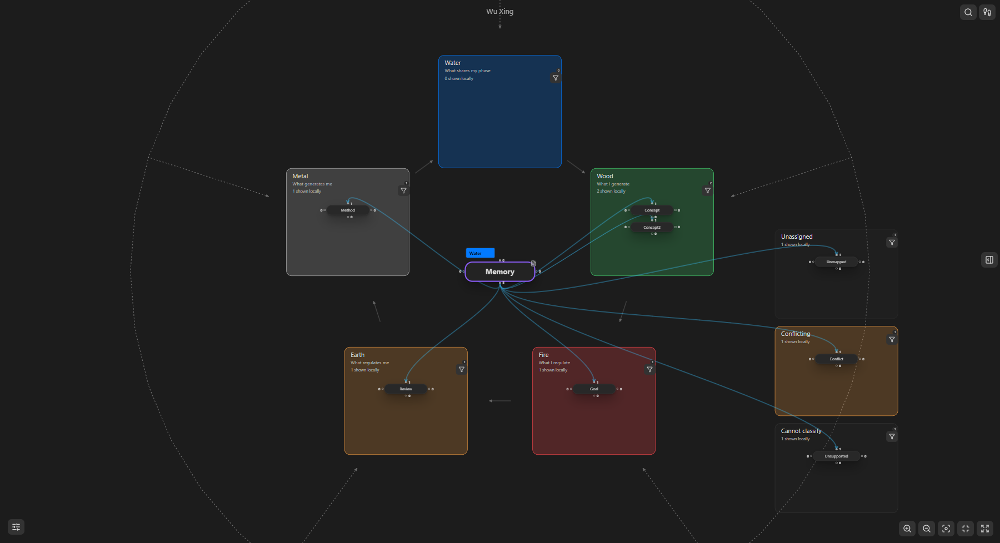

# Facets

Facets places the current note in the center and its directly related notes in configurable category regions. Its colored badge shows the current note's classification. The surrounding categories do not replace the recorded relationships between notes.

Open **Views and lenses → Canvas view → Facets**. Choose a preset in the same panel. Manage definitions under **Settings → K-Plex → Canvas behavior → Views → Facets**. Each canvas keeps its own selected view/preset, camera and attention; definitions are shared settings. Switching views preserves lenses, filters and unsaved lens drafts.

## Choose a preset

The view and preset dropdowns share a row when space allows. Select the cog beside the view to open its settings page. Select the cog beside the preset to edit that preset directly. The preset selector, cog and Info remain together when the row wraps. Opening settings keeps the canvas selection; Cancel discards the preset draft. The larger editor uses one compact icon-action row with accessible tooltips. **Reset preset to defaults** changes only the draft and shows feedback; Save applies it and Cancel discards it. **Copy JSON** and **Save JSON file** export the current draft without saving it.

| Preset | Default property | Categories | Preview |
| --- | --- | --- | --- |
| Wu Xing | `status` | Wood, Fire, Earth, Metal, Water | Emoji-based Five Phases |
| Local map roles | `map-role` | Hub, Supporting map, Concept, Reference | [Obsidian screenshot](images/facets/preset-map-roles.png) |

These are the only built-in presets. ARC, PARA, GTD horizons, eACCESS, Sensemaking and Publishing pipeline remain available as [importable JSON packages](../presets/facets/README.md). Saved user definitions are retained. If an older canvas selected an inherited preset that is no longer present, importing its original ID restores that definition without rewriting the canvas selection.

Screenshots use separate diagnostic areas to show their individual states; new presets combine diagnostics by default. These are editable examples inside one Facets view. You can create/duplicate presets with three to seven stable categories, rename/reorder them, choose colors, matching aliases and explicit assignment values, and adjust layout defaults. Deleting a preset asks for an explicit replacement so saved canvases remain recoverable. Restore defaults changes the local draft until Save. Cancel keeps the accepted definition.

The archived Sensemaking example combines `approach: top-down` or `bottom-up` with `mode: reflection` or `expression`. Missing metadata stays unknown; rules do not infer intent from prose. Local map roles are personal classifications, with no importance score or vault-wide ranking. Archived preview images illustrate optional imports, not additional built-in choices.

Select the Info button immediately after the preset cog to read that preset's Help. Built-in Help follows the application language until you save a literal override. **Edit → Help** offers Markdown source and a native preview; Save uses the existing preset writer, Cancel discards the draft, and Reset restores the localized default. A deliberately blank override stays blank. Help supports headings, lists, code examples and HTTPS links. Code fences are displayed as plain examples; HTML, embeds and executable Markdown are not enabled.

Current native interface examples: [wide preset editor](images/facets/ux-preset-editor.png), [wide selectors](images/facets/ux-selectors-1280.png), [narrow selectors](images/facets/ux-selectors-640.png). These are genuine Windows captures; [current acceptance limits](validation/facets-222-ux-2026-10-26.md) remain explicit.

## Choose a layout

Open the preset cog, then choose **Layout** in the preset editor. Choose circular, concentric rectangles, vertical stack, horizontal spread or four-category quadrants. Layout belongs to the preset: saving it updates canvases using that preset. Canvases keep their independent selected presets, attention, editor and camera intent. Legacy per-canvas layout overrides no longer take precedence. Quadrants is unavailable for other category counts; a saved incompatible choice visibly falls back to circular while preserving every category.

Native Obsidian examples with the same attention editor retained: [circular](images/facets/layout-circular-editor.png), [concentric bands](images/facets/layout-concentric-editor.png), [vertical](images/facets/layout-vertical-editor.png), [horizontal](images/facets/layout-horizontal-editor.png), [quadrants](images/facets/layout-quadrants-editor.png). These full-fit screenshots show the entire arrangement; zoom in to inspect individual cards or edit at a comfortable size.

The preset editor sets layout, category order and reversal. Linear layouts also offer top, bottom, left or right placement of the focused note, with a schematic preview. The note and its native editor appear once. These controls change placement without changing classification or recorded relationships.

Resize a category or diagnostic area using its side and top/bottom handles. Keyboard arrows adjust the selected handle; Home/End choose its limits. Width uses Shift for one-unit steps. Wider areas automatically use more columns when measured cards fit. In the preset editor, optional exact width/height values set individual area defaults; blank inherits the preset default, and canvas handle adjustments take precedence.

Concentric categories are distinct rounded rectangular bands with genuine inner holes. Width and height mean horizontal and vertical **band thickness**, rather than the full outer frame. Notes use a bounded scrollable top strip in each band. Resizing an inner band moves its enclosing bands; the outer band cannot intercept a drop inside an inner category.

Diagnostics are combined by default, with each note's own status chip. **Configure Canvas Layout → Combine diagnostics** changes only this canvas. The preset editor sets the shared default, dock side, separate-area orientation, status order and empty-area visibility. Combined and separate modes retain independent sizes. Dropping into the combined Diagnostics area never means clearing a property; use the explicit category actions or a writable, separately labeled Unassigned area.

In **Workflow guides**, configure decorative arrows for vertical and horizontal layouts. Choose forward, backward or both directions, an arrow, plain line or no line, and an optional caption at the start, middle or end of its outer rail. Enable individual adjacent-category overrides when needed; turning one off restores the preset defaults. A blank overridden caption intentionally suppresses the inherited caption. The logical category sequence stays the same when its geometry is reversed, so a forward workflow can point upward or leftward.

Guides route outside category regions on the side away from the focused editor. Captions use the shared measured text treatment and are bounded to 80 characters; long visible copy stays clipped to its measured background. They never create relationships or receive graph editing actions. Concentric/quadrant layouts use their category geometry without workflow rails; circular Wu Xing retains its distinct generating and regulating cycles.

The supplied [sample vault](../tests/fixtures/facets-vault/README.md) includes all eight built-in presets plus a custom four-category **State** example (`seed`, `research`, `draft`, `published`; [Obsidian screenshot](images/facets/preset-state.png)). Ready for review is recognized by Publishing and intentionally Unassigned in the custom State definition. The vault contains Markdown/configuration only, with no executable plugin. Use a separate disposable copy with the matching reviewed build; do not overwrite an existing vault's settings.



## Classify from one source

Select one source per preset: a Markdown property, note type, tag mapping or advanced rules. Property matching trims whitespace and preserves case. For example, default Wu Xing recognizes `wood`; add `Wood` as an alias if your notes use that spelling. Scalar/list values can match one category; matches in multiple distinct categories are conflicting. An alias alone does not grant write authority: assignment requires an explicit safe canonical value.

Empty categories remain visible. **Unassigned** means no configured category matched available data. **Conflicting** means multiple categories matched. **Checking…** is reserved for active preparation; persistent or unsupported metadata/rules show **Cannot classify** with a classification explanation. These notes remain reachable and are not silently assigned a phase.

Advanced rules reuse the shared Graph Lens conditions and Code grammar:

```text
note.phase == "water"
note.state == "draft" && note.priority >= 3
edge.role == "parent"
this.phase == "wood" && note.phase == "metal"
```

`note` reads the candidate. Availability-aware Facets rules explicitly read non-reserved `this` fields from this canvas's current note; fixed attributes such as `this.name` keep their usual meaning. Unavailable metadata stays unknown under negation. Strict `==` preserves case/type; `.equals()` compares text without case. Switching to Simple is refused if it would change the expression's meaning.

Relationship rules use actual recorded canonical contexts, with any-match within a category and conflicts across categories. The current note has no fabricated self-link. Rule classification stays separate from enabled filtering/styling lenses. General arithmetic or date calculations are outside this version.

## Assign deliberately

For a property preset with a safe explicit assignment value, use **Assign category** on a note or drop its body into a category. A native preview shows the note, property, current/proposed values and effect. Review it before assigning. Classification alone does not create a link; **Connect without assigning…** opens the existing connection workflow separately.

Lists retain unrelated values and order. Assigning an existing category is a no-op. Unassigned removes only values recognized by that preset. Reserved/current ontology, tag, type, alias, name and image properties remain protected. Tag/type/rule presets stay read-only for this action. Dirty native buffers must be saved first.

**Undo category assignment** reverses the last applied field value for this canvas only while that exact value is still current. Later edits, retired notes or changed owners are not overwritten. This receipt is temporary, not a replacement for Obsidian's note history.

## Read Wu Xing relative to the current note

Original term: Wu Xing (五行), pinyin **wǔ xíng**; here it is presented as Five Phases. A saved phase records your classification of the note. The optional relative labels explain that classification against the current note's phase.

The default follows Dumo's `status` convention: 🟢 Wood, 🔴 Fire, 🟤 Earth, 🟡 Metal and 🔵 Water. For example, use `status: 🟢`, or a list containing the same phase. Plain English phase IDs remain accepted aliases. Wood starts at the top; Fire, Earth, Metal and Water follow clockwise with green, red, brown, yellow and blue colors. Existing saved presets keep their own property/mappings, including older `phase` configurations.

The generating cycle is **Wood → Fire → Earth → Metal → Water → Wood**. Regulation skips one phase forward. Reordering the visible regions does not reorder this model.

| Candidate phase | With Wood current | With Metal current |
| --- | --- | --- |
| Wood | What shares my phase | What I regulate |
| Fire | What I generate | What regulates me |
| Earth | What I regulate | What generates me |
| Metal | What regulates me | What shares my phase |
| Water | What generates me | What I generate |

Following another note updates these explanations without changing either note's saved phase or recorded links. Keyboard selection, hovering, resizing and reclassification do not independently retarget the native editor or Sidecar. An unassigned, conflicting or unavailable current phase supplies no default reference; there is no automatic Wood assignment on opening.

Solid directed guides show generation. Dashed directed guides show regulation. Both connect phase regions as decorative model explanations. They cannot be selected as editable relationships, and neither proves causation. Actual note connectors continue to require recorded graph evidence.

The prototype by [Dumo Guo at fixed commit fa038f0](https://github.com/dumodal/kplex-wuxing/tree/fa038f0af796a9a6f42e6f8eb91e44c13ba3e067) was reviewed as a functional reference. [The specification's parity assessment](FACETS_VIEW.md#functional-reference-dumos-fixed-wu-xing-prototype) separates implemented reference behavior from its proposed interactive onboarding. A count-weighted balance star, automatic perspective tilt, separate bilingual display preference and richer onboarding remain future opportunities.

## Shared canvas behavior

Facets uses the existing measured nodes/links, bounded area overflow, grouping, Find, keyboard actions, navigation and Sidecar. Its native editor follows the current note and retains the normal save/switch/resize lifecycle. Decorative guides have no relationship-edit authority.

In **Area settings**, drag a region's bottom handle downward to grow it or upward to shrink it. Unassigned, Conflicting and Cannot classify use the same controls and keep independent sizes in each canvas. These status sections sit apart from the category regions on the right.

Alt/Option-click explicitly centers a note through the shared navigation action. Ctrl/Cmd placeholder creation keeps its existing meaning. Wander uses the displayed navigable notes in every registered view. Mind Map's ordinary branch clicks retain its root; cycle references reveal their earlier occurrence and explain the cycle.

Section expansion remains hidden in production Facets and Mind Map. Compass retains its existing section behavior. The reusable section boundary is tested separately and is not a shipped Mind Map section mode.

## Attribution and validation

Preset and lens import/export use one versioned data-only format, native preview and the existing queued writer. Exports include effective Help and separate inert AI authoring context. Optional lens dependencies must be selected explicitly; imported lenses remain disabled. See [portable sharing](PORTABLE_PRESETS.md), [authoring instructions](FACETS_AUTHORING.md) and [validated example JSON](../tests/fixtures/portable-presets/README.md).

PARA terminology is informed by [Forte Labs](https://fortelabs.com/blog/para/). GTD horizons are informed by [Getting Things Done](https://gettingthingsdone.com/2011/01/the-6-horizons-of-focus/). ARC and the seven-category eACCESS arrangement are editable K-Plex adaptations, with [Linking Your Thinking](https://www.linkingyourthinking.com/) as related background; they are not claims of an official workflow definition.

See the [#220 validation record](validation/facets-220-2026-10-25.md) and [#222 native checkpoint receipts](validation/facets-222-native-summary.json) for actual results and remaining Windows, Mac, physical-mobile and baseline limitations. PR #220 is merged; #222 remains draft and unmerged while expanded implementation and validation continue.
