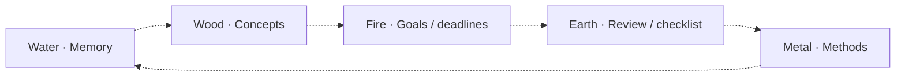

# Wu Xing five-phase canvas view

Prepared by Zsolt's Codex Agent, 2026-10-24. **Planning draft for the Windows agent. No runtime implementation or validation is claimed.**

## Baseline and dependencies

Planning branch: `2026-10-24-canvas-wuxing`, created from accepted `main@659697a686f341497725dfb31e94a8bc2bcf2b25`. Reviewed foundation: [#215](https://github.com/zsviczian/kplex/pull/215) at `030d0f0558c78b25be0d27fba40caca60b9361cd`.

Depends on [Canvas settings #218](https://github.com/zsviczian/kplex/pull/218) and the **isolated M0 occurrence-editor/rooted-session checkpoint** owned by the [Mac/Mind Map assignment #219](https://github.com/zsviczian/kplex/pull/219). It does not depend on completing the Mind Map product layout.

**Before implementation, fetch and integrate latest accepted main into this existing branch. Confirm #215 and #218 have landed, record the actual base SHA, reread AGENTS.md, CONTRIBUTING.md and the accepted architecture/settings contracts, and update this plan to match them.** Preserve concurrent changes. Do not assume the planning base or proposed API names are current.

Pure phase classification, layout and configuration fixtures can proceed while Mac validates M0. Production/native integration must wait for the accepted shared hosting checkpoint. This preserves #215's explicit prerequisite; do not independently implement another native editor or silently downgrade to attention-only hosting. No merge, force-push, release or personal-vault deployment without authorization.

## Goal

Show the current subject through five configurable phases arranged around a cycle. Notes occupy phases according to an explicit property, existing note type or tag mapping. The current note is one participant in the field, not a permanently central hub. The local distribution can prompt the user to consider missing kinds of work without asserting that a particular workflow is universal or complete.

The first version is a **local property-driven five-phase view**. The earlier sketch's relative family positions (attention, children, grandchildren, grandparents, parents, with siblings beside attention) are a distinct possible projection. Keep that generational interpretation out of this implementation; do not pretend property classification and graph distance are equivalent.

## Source basis and interpretation limits

The maintainer supplied Dumo's community-call demonstration in `captions.sbv` and an earlier relational sketch. Relevant transcript intervals:

- 00:58:45–00:59:08: the important change is the ontology and changing relationships, rather than geometry alone.
- 00:59:17–01:00:09: notes have categories/status; a project passes through five phases, and the spatial distribution suggests what kind of notes/work to add.
- 01:01:17–01:02:51: water is associated with memory; concepts/lexicon follow; fire means goals/pressure/deadlines; earth includes review/checklist after a demo; a methodological update feeds the loop.
- 01:03:14–01:04:33: completing the cycle is not automatically reaching a higher level; starting perspective differs; a methodology note is associated with metal.
- 01:06:37–01:07:10: placement between categories is discussed as an interesting possibility, not a settled requirement.

These are descriptions from the supplied transcript, not a source-code audit or a frame-by-frame reconstruction of Dumo's screen. Exact property names, matching rules and all geometry are unspecified. Do not invent those as observed facts, publish the entire private call, or claim exact compatibility with her fork. Persist no birthday/astrological/personality information; none is needed for this feature.

### Supporting schematic

The following is a **proposed configurable preset**, inspired by the call. It is a semantic cycle guide, not a screenshot or the required final pixel layout. The Concepts label under Wood is a proposed completion of the preset, not an independently verified property mapping from the demonstration.

Dashed arrows here mean **phase order only**. The implementation arranges five regions around a ring/pentagon; actual note connectors still require canonical relationship evidence. Names, explanatory labels and source values are configurable; the user can keep the phase names without adopting these example meanings.

## W0 — Agree shared interfaces before touching common files

Read #219's current M0 contract and #218's effective settings/configuration contract. The Mac agent owns editor bindings, rooted session policy, shared occurrence editor actions and native lifecycle. The Windows agent owns a narrow cached-property bridge and noninteractive background/decorations contribution, after agreement on their interface.

The reviewed #215 `PlexViewRead` exposes nodes, relations and evidence, but no arbitrary-property accessor. Reuse the existing `GraphPropertyProvider` and [`createLegacyPropertyProvider`](https://github.com/zsviczian/kplex/blob/030d0f0558c78b25be0d27fba40caca60b9361cd/src/adapters/obsidian/predicateContracts.ts) for field-scoped metadata-cache reads. Add only the explicit availability/lifetime adapter needed by this consumer; pure definitions never receive App, GraphIndex, TFile or a complete frontmatter object.

Expose view labels/tints/cycle guides through a small shared background contribution rendered by the existing host. It is input-transparent and theme-aware. #215 rejects policy-created synthetic nodes and reserves synthetic grouping for the shared owner: do not fabricate indexed notes or synthetic thought nodes to draw empty phase regions. Do not fork the renderer or place a private application inside the canvas.

Publish the interface agreement and isolated capability commits on the PR before changing `contracts.ts`, `prepareScene`, `PlexGraph`, contributions or session/action owners. These files have one agreed editor at a time.

## W1 — Local admitted scope and classification

Use current attention plus its bounded direct relationships through the existing canonical read/demand owners. Deduplicate canonical notes within this local projection; phase membership does not create relationships. No whole-vault query, corpus scoring, new index, body parser or private scan. Respect hidden relationships, node visibility, inferred settings and existing lazy publication.

Classification source is one explicit choice:

1. A configured Markdown property (for example `phase`; this is a suggested field, not Dumo's actual field).
2. The existing note-type facet.
3. Configured tag values using the existing tag representation.

A category and a workflow status may coexist in a vault; choose which dimension this view interprets. Do not infer precedence by combining them. Folder-based classification, arbitrary formulas and fallback chains are deferred.

Map raw values to five stable phase IDs. Display labels can be localized/customized, but stored property/tag values and stable IDs must not change with UI language. Define and test a matching policy explicitly; suggested initial policy is trimmed, exact configured values, with aliases supplied explicitly rather than guessed translations or element synonyms.

For scalar or list values, one uniquely matched phase admits the note there. Repeated aliases for the same phase still yield one membership. Two distinct matched phases are an explicit conflict/unclassified result in v1; do not silently take the first or duplicate the note across phases. Preserve mixed CJK/Latin values. Unmapped/unsupported target kinds remain reachable in a compact Unclassified region outside the five-phase cycle.

Distinguish **known missing/unmapped** from **metadata unavailable**. The existing property's `undefined` result alone cannot establish which condition applies; the host must check the current file/cache availability through the existing boundary. Late metadata results cannot survive changed file identity, source/publication revision, view lifetime or configured field. Read only the selected field for admitted nodes and copy no full note/body/frontmatter into view state.

Reclassification from a configuration change is presentation work. An actual edit to a note keeps the normal incremental indexing behavior; do not claim all such edits perform zero source work. Observe existing presentation/metadata notifications and retire listeners on close/switch. Never turn absent cache data into an empty/complete phase.

Counts describe **shown local notes**. Under partial relation coverage, `0 shown` is not proof that no relevant note exists elsewhere. Avoid completion percentages or advice claiming a project must contain all five phases.

## W2 — Situated cycle layout and interactions

Create five labeled phase regions around a ring/pentagon with deterministic ordering and measured node packing. Reserve visible space for empty phases. Keep the attention occurrence inside its mapped phase, with an emphasis distinct from phase color; do not invent a permanent central self node. Unclassified/unknown notes remain selectable outside the cycle.

Default to a stable phase orientation. A configurable starting phase may rotate the phase sequence as a discrete presentation choice; continuous rotation or auto-rotation on every click is deferred. Changing attention rebuilds the bounded local neighborhood, providing the changing perspective without claiming a complete global map.

Use measured thought/editor bounds to avoid overlap, with bounded overflow/reflow for dense regions. Reuse shared filtering/grouping/Find/keyboard mechanisms and theme/native typography. Group by phase and the shared kind/note-type rule; do not group attention or a live editor away. Unfolding remains presentation-local. Support Keep/Reflow consistently.

Phase guides and region tints are decorative. Note connectors are canonical semantic relationships with actual endpoints, provenance and physical ports independent of phase placement. Never fabricate an edge from one phase to the next or expose relink/unlink on a decorative guide. Arbitrary phase areas have no semantic drop role by default.

Clicking a note uses ordinary shared activation and document synchronization for that canvas. In-place editing uses M0's shared occurrence actions and exact binding; focus elsewhere cannot silently retarget a live editor. A local-neighborhood change that would remove that editor must use M0's explicit safe transition policy. Keep native editor, Sidecar, independent window focus and history/Footprints under their current owners. Do not require Wu Xing to duplicate Mind Map's click-to-edit policy to reuse the editor capability.

No phase/status writes from dragging or merely selecting a note. Existing explicit relationship commands may remain available through shared controls when their canonical targets are eligible, but never infer their meaning from a phase position.

## W3 — Type-specific settings

Register stable ID `wuxing` and user-facing **Wu Xing** in #218's accepted contribution mechanism under Canvas behavior > Views. The page description can explain five-phase local exploration in one sentence.

Initial configuration: classification source and field, five labels/value aliases, cycle order/starting phase, spacing/region size and whether to show subtle phase guides/tints. Keep the first version small: use existing native input/dropdown/list/color components, searchable selectors where existing capabilities support them, and short plain labels. Follow the existing style-manager UX for any genuinely needed mapping manager; do not invent a separate modal/toolbar system.

Reuse global themes/palette/native color resolution. Phase color is an optional presentation accent, not a replacement for node-type styles or lens overrides; labels and shapes must distinguish phases without color alone. Reuse shared editor defaults, visibility, safety limits and input preferences rather than duplicating them.

Type configuration applies to all canvases using this view through #218's serialized writer. Current attention, camera, expanded groups and editor bindings remain local session state. Changing mappings must not change the canonical ontology or another view's settings. Preserve unknown/future payloads and existing external-settings synchronization; field-level updates must not overwrite the other agent's type namespace.

## W4 — Fixtures and acceptance

Prepare a small disposable fixture based on the described workflow, with ordinary note properties and real links: memory note, concept note, goal/deadline note, review note and method note. Also include unmapped, missing-property, unavailable-cache, conflicting-list, duplicate-alias and non-Markdown targets. This is an illustrative fixture, not Dumo's private vault.

Required checks:

- All five regions and optional cycle guide render with zero, sparse and dense admitted notes. Unknown and unclassified remain distinct from a proven empty local result.
- Field, note-type and tag mapping obey explicit rules; multilingual labels/raw values, list conflicts, missing cache, rename/deletion and rapid setting changes are deterministic and stale-safe.
- Display-only configuration, hover, camera, tint and classification cause no note-body reads, parses or semantic rebuilds. Actual note edits use normal owners. No whole-vault enumeration for this local view.
- Guides remain noninteractive/non-writable; semantic connectors retain evidence and role meaning regardless of screen position. No inferred status/ontology mutation from phase movement.
- Shared lens/Find/grouping/keyboard/activation/Sidecar behavior and separate canvas sessions work; closing one does not release another's demand or editor.
- After M0 acceptance, arbitrary occurrence editor/caret/dirty-state survives layout and attention changes subject to explicit scene-retirement policy. Capacity-one is truthful. No local editor implementation.
- Phase mapping settings round-trip and synchronize without changing Compass or Mind Map configuration. Settings search/deep links/localization use the accepted #218 framework.
- Node22.22.2 `npm run verify`, focused pure classifier/layout/property-lifetime/session/browser tests, actual Windows native modifier/clipboard/editor/Sidecar/popout checks and exact-head CI pass. Report mobile emulation and physical-device evidence separately.

Highest-value manual checks: edit a phase property and see the correct local move while saved content remains correct; navigate a sparse/unknown local scene with keyboard and Find; run an editor alongside independent canvas/Sidecar pairs across close/reopen. Preserve #215's documented baseline extra-tab/combined-editor failures and distinguish them from new regressions.

## Parallel communication and integration

The partner is [Mind Map #219](https://github.com/zsviczian/kplex/pull/219). Read its PR and current M0 contract at kickoff, before shared-interface changes and before native integration. Fetch remote work read-only as needed. Commit/push coherent milestones (agreed interface, classifier/layout, property bridge, native integration, validation), then post a short PR message signed **Zsolt's Codex Agent** with SHA/link, capability, tests actually run and remaining dependency.

A commit being visible does not make it accepted. The integration owner must land the isolated shared checkpoint on main or explicitly approve exact dependency commits. Do not automatically merge/cherry-pick the entire Mind Map branch, implement a competing M0, or repeatedly modify shared files while the Mac agent is editing them. If the host prerequisite is unavailable, complete fixture-level work and report the gate honestly.

Keep each branch's HANDOFF.md focused on its own assignment; cross-agent contracts/decisions live on the PRs. The user may revise both feature scopes after #218; refresh the drafts against that actual result before proceeding. No timer-based commit noise or promise of asynchronous communication outside an active implementation session.

## Exclusions and delivery

No relative-grandparent/grandchild mode, multiple simultaneous editors, automatic phase assignment, between-phase overlap, phase-changing drag/drop, astrology-derived classification, full-vault metrics, 3D/forces/continuous animation, private parsing/indexing, external plugin loading or C15–C26 refactor.

Return the actual phase/settings contract, agreed shared capability commits, source/build identities, tests and failures, cleanup receipts and up to three necessary manual checks. Keep the PR draft until the view and shared hosting prerequisite are validated. The opening planning document itself is not a completed feature.
